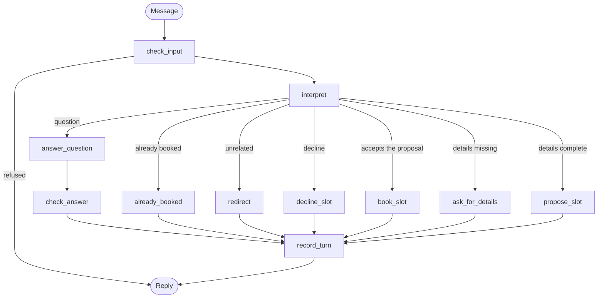
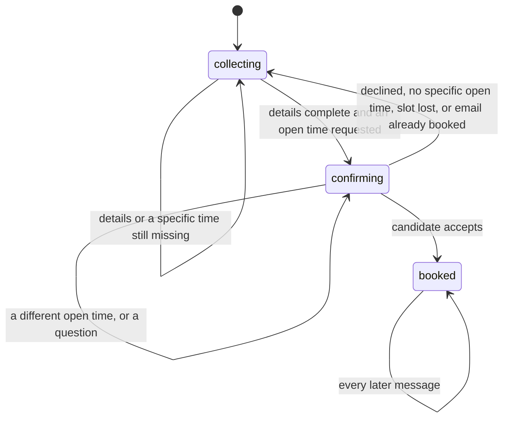

# recruiter-scheduling-agent

[](https://github.com/tuliovargasrj/recruiter-scheduling-agent/actions/workflows/ci.yml)

A chat agent that answers candidates' questions and books a call with a tech recruiter. It runs on FastAPI, uses `gpt-4o-mini` to understand messages, and uses a LangGraph state machine to control the conversation.

```text
Candidate: Hi, I'm Ana Lima, ana@example.com. Can we talk Tuesday at 2pm?
Agent:     Sam Rivera is free on Tuesday, November 10 at 14:00. Book it?
Candidate: How long does the call take?
Agent:     The call takes 30 minutes.

           Shall I book Tuesday, November 10 at 14:00?
Candidate: Yes
Agent:     You're booked with Sam Rivera on Tuesday, November 10 at 14:00
           for a 30-minute video call.
```

The company, recruiter, and calendar are fictional.

## Why it exists

An LLM is good at understanding "next Tuesday after lunch" and bad at being the source of truth for a calendar. If the model controls booking, it can invent a free slot or confirm a call that never happened.

This project keeps those jobs apart: **the model interprets, and the code decides.**

## Quick start

Requires [uv](https://docs.astral.sh/uv/) and an OpenAI API key.

```bash
git clone https://github.com/tuliovargasrj/recruiter-scheduling-agent.git
cd recruiter-scheduling-agent
cp .env.example .env
```

Add your key to `.env`, then start the server:

```bash
uv run uvicorn scheduling_agent.api:create_app --factory --port 8000
```

Open <http://localhost:8000> to use the chat page, or call the API directly:

```bash
curl -X POST http://localhost:8000/chat \
  -H "Content-Type: application/json" \
  -d '{"message": "What does the first call cover?"}'
```

Send the returned `session_id` with the next message to continue the conversation. Interactive API docs are at `/docs`.

## Architecture

Each message runs the graph once. Between messages, a LangGraph checkpointer keeps the conversation's state.



`route_intent` checks these branches in the order shown, after `question`. For example, once a call is booked, `already_booked` takes priority over every branch below it.

The conversation's stage is derived from its state, so contradictory states cannot exist:



| File | Responsibility |
|------|----------------|
| [`graph.py`](src/scheduling_agent/graph.py) | State machine, routing, and reply text |
| [`llm.py`](src/scheduling_agent/llm.py) | OpenAI client behind a small interface |
| [`guardrails.py`](src/scheduling_agent/guardrails.py) | Input and output checks |
| [`recruiter_calendar.py`](src/scheduling_agent/recruiter_calendar.py) | Availability and booking |
| [`prompts.py`](src/scheduling_agent/prompts.py) | Prompts and the facts the agent may use |
| [`models.py`](src/scheduling_agent/models.py) | Shared data types |
| [`config.py`](src/scheduling_agent/config.py) | Settings from the environment |
| [`api.py`](src/scheduling_agent/api.py) | HTTP endpoints |
| [`static/index.html`](src/scheduling_agent/static/index.html) | Chat page |

## Guardrails

The structural controls below hold even if the model is manipulated, because they limit what can happen rather than what the model says.

| Risk | Structural control |
|------|--------------------|
| The model books something by itself | It has no tools. Only `RecruiterCalendar` creates bookings, and only the graph calls it |
| Booking with nothing proposed | Booking requires a proposal that came from the calendar |
| Inventing a free slot | The model's date only filters real slots |
| Inventing an email | The model has no email field. The address is read from the candidate's own text |
| Inventing a name | A name is accepted only if it appears in the candidate's message |
| Double booking | The calendar checks and reserves under a lock, with one slot per candidate email |
| Oversized messages | The API rejects them before they reach the graph |
| Runaway cost | Turns per conversation and output tokens are limited |

Consent is the one decision left to the model's reading. It decides whether a message means "yes", and it is told that a "yes" asking for any change is not an acceptance. The code limits the damage of a mistake: a wrong "yes" can only book the slot already proposed in that conversation, a "yes" naming a different day or time becomes a new proposal, and a vague change such as "a bit earlier" lists the day's other open slots.

Two more filters catch common cases. They rely on pattern matching, so they can be bypassed:

- Known prompt injection phrases are refused before reaching the model, and refused messages stay out of its history.
- Answers are replaced if they repeat a canary token from the prompts, contain a clock time, or match common phrases claiming a booking.

### Design decisions

**No agent tools.** Tool calling would let the model trigger a booking directly. Here it returns structured data, and the graph treats that data as a claim to verify.

**Replies about slots are templates.** Only answers to general questions are written by the model, which keeps availability and booking text accurate.

**No guardrails framework.** The checks that matter depend on this app's state, so plain code is shorter and easier to test.

**Checkpoints restore an explicit list of types.** Otherwise LangGraph's deserializer can import any class named in a checkpoint.

## Limitations

- Conversations and bookings live in memory and are lost on restart. Production use would need a persistent checkpointer and a real calendar.
- There is no authentication or per-client rate limit, so it should not be exposed publicly as it is.
- Emails are not verified, so anyone can type someone else's address.
- After a question, the reminder can name a slot another session has just taken. Booking it is refused, and the agent offers open slots.
- Rescheduling and cancelling are not supported.
- Fixed replies are in English.
- No confirmation email or calendar invite is sent.

## Development

```bash
uv run pytest
uv run ruff check .
uv run ruff format --check .
uv run mypy
```

Tests need no API key and cost nothing. They run whole conversations through the HTTP API with a scripted model, and they run the real OpenAI client against a fake HTTP transport.

To run the paid end-to-end tests against `gpt-4o-mini`, with your key in `.env`:

```bash
uv run pytest -m live
```

Live tests assert what code can check, such as whether a booking exists. Consent is the part code cannot check, so an LLM judge with its own prompt reads each exchange and must agree with what the agent did: a reply it reads as an acceptance must have booked, and any other reply must not. It reads a single exchange because a judge reviewing whole transcripts was too unstable on this model to fail a test.

## Roadmap

- Google Calendar integration
- Rescheduling and cancelling
- Voice input and output
- Persistent conversations with a SQLite checkpointer

## License

MIT
